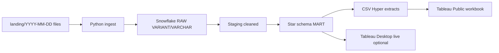

# Retail Sales Interview Case — Updated Plan

## Interview context (keep in mind, do not rebrand the case)

This is still the **retail grocery** dataset and brief. **WPP Production BD** is only the hiring lens: they will like production-grade thinking — daily incremental feeds, raw-vs-curated layers, DQ as a pipeline SLA, a reporting mart other analysts can join, and clear “why this design” answers. Do not put WPP logos or media-campaign metrics on the dashboard.

## File access (confirmed)

All four files in [c:\Users\Dell\Downloads\Retail_Sales_Data_Analyst_Project](c:\Users\Dell\Downloads\Retail_Sales_Data_Analyst_Project) are readable:

- `Customers.json` — 13,993 customers, nested `Phones`
- `Retail_Sales.xlsx` — 60,000 headers (`Unnamed: 9` = Customer_ID)
- `Retail_Items.xlsx` — 80,000 lines; only 26,667 sales have items
- requirement brief `.docx`

## Snowflake — what we have vs what we still need

**Have:** trial account [tasuvwl-ih32543](https://tasuvwl-ih32543.snowflakecomputing.com), user `MAF345`.

**Still needed at run time (do not paste the password into chat):**

- Password (or key-pair) stored locally as env vars / `.env` (gitignored)
- Confirmation the default warehouse `COMPUTE_WH` is active
- We will create `RETAIL_SALES` (or similar) database + `RAW` / `STAGING` / `MART` schemas on first run

I can write and run the Python + SQL against this account once credentials are in the local environment. You stay logged in for any MFA/browser prompt.

## Tableau Public constraint (you chose both)

[Tableau Public](https://public.tableau.com/app/profile/maf345/vizzes) **cannot connect live to Snowflake**. Production story vs what we can publish:

- **Intended architecture (PPT + SQL):** Snowflake mart is the system of record; Tableau Desktop would live-query it.
- **What we actually ship for your profile:** Python exports mart tables to `extracts/` (CSV or Hyper). Tableau Public Desktop connects to those files. You publish to [maf345](https://public.tableau.com/app/profile/maf345/vizzes).
- PPT will say this explicitly so it looks like a tooling constraint, not a missing mart.

## Will I do everything? Yes, with a split of who clicks what

| Layer | I build | You do |
| --- | --- | --- |
| Dated landing + Python pipeline | Code, run, DQ logs | Provide Snowflake password via `.env` |
| Snowflake RAW / star / mart | DDL + load + sample queries | Approve first login / MFA if asked |
| Tableau | Data extracts + workbook built against extracts (dashboards, KPIs) | Open Tableau Public, refresh if needed, publish to your profile |
| PPT | Full deck: approach + findings | Rehearse; tweak wording |

I will not stop at SQL. Deliverables include pipeline, Snowflake objects, Tableau workbook + extracts, PPT, README, ZIP structure.

## ELT vs ETL — the answer they want

**Honest design: hybrid ELT, not a religious choice.**

- **ELT (load first):** Land Excel/JSON into Snowflake `RAW` with minimal change (`VARIANT` for JSON, VARCHAR for dirty Excel columns). Reasons they like: (1) **replay** — if a business rule changes you do not re-read source files; (2) **audit** — raw is the evidence of what arrived today; (3) **scale** — transforms run in Snowflake; (4) **JSON** — `VARIANT` + `LATERAL FLATTEN` is native; (5) WPP-style production — daily files are ingested as-is, then curated.
- **ETL (transform first) is weaker as the only pattern here** because you would throw away the raw payload and mix file-parsing with business logic in Python.
- **Where Python still does ETL-like work (say this out loud):** parsing `.xlsx`/`.json` files, `$` / `pcs` / `%` coercion, renaming `Unnamed: 9` → `CUSTOMER_ID`, row-level DQ before MERGE. File formats are not Snowflake’s job; **modeling is**.

One-liner: *“Python is the ingestion + contract layer; Snowflake is the transform + mart. That is ELT with a thin extract.”*

## Why star schema (keep this)

- Facts (`fact_sales`, `fact_sales_items`) hold **events and measures**; dims hold **descriptive grain** (date, store, product, customer, payment).
- Tableau (and any analyst) filters on dims without fan-out if grain is correct — **one row per sale in the header fact; one row per line in the item fact**.
- Time intelligence (YTD/MTD/QTD/MoM) needs `dim_date`.
- Guests: `customer_sk` **nullable** on `fact_sales` — do not invent a fake customer.
- Snowflake micro-partitions + clustering on `sale_date` / `store_id` scale better than one wide denormalized dump for daily incremental MERGE.
- **Cashier is 1:1 with store in this data** — put cashier attributes on `dim_store` (or a thin `dim_cashier`) and say so; do not pretend independent cashier performance.

Snowflake flattening of customers:

- `RAW.CUSTOMERS` stores the JSON document (`VARIANT`) plus load date.
- Transform: `LATERAL FLATTEN` on `Phones` → `STAGING.CUSTOMER_PHONES`.
- Mart: `dim_customer` (one row per customer; **Active** phone as columns for easy joins) + optional `dim_customer_phone` (all numbers, Active/Inactive) if they ask about history/multi-phone.
- **Yes — after flatten, everything is relational** (`CUSTOMER_ID` joins `fact_sales`). Tableau never queries nested JSON.

## Incremental architecture — dated landing (yes)

You only received one snapshot, but the brief says **daily incremental load**. We will **simulate production**:

```text
landing/
  2026-10-10/          # processing date (file arrival date)
    Retail_Sales.xlsx
    Retail_Items.xlsx
    Customers.json
  2026-10-11/          # next day would drop here
```

Pipeline behavior:

1. Job argument `--as-of-date YYYY-MM-DD` (default: latest folder).
2. Copy/treat today’s files as that folder (first run: the three files you already have).
3. Load into `RAW` with `_LOAD_DATE`, `_FILE_NAME`, `_INGESTED_AT`.
4. `MERGE` into staging/mart on `SALE_ID` / `ITEM_ID` / `CUSTOMER_ID` using `UPDATE_DATE` (newer wins). JSON customers: full snapshot merge (typical for a small dim).
5. DQ: count new/updated/unchanged; **orphan items**; **sales without lines** (already ~55.6% — treat as an ops KPI, not a silent drop).
6. Idempotent: re-running the same dated folder does not duplicate facts.

We will **not** invent a second day’s fake files unless useful for a demo screenshot. The code path and PPT diagram will show the next-day folder.



## Data issues the mart must handle

- Rename `Unnamed: 9` → `CUSTOMER_ID`; Members always have it, Guests never.
- Parse `$`, `p`/`pcs`, `%`; `Total_Value` already matches formula after parse.
- Item coverage only `Sale_ID` 100000–126666 — header KPIs vs product KPIs use different filters.
- `Gender = Unknown` (569); keep as its own member, do not impute.

## Analyses (unchanged intent)

Churn defined for **Members only** (e.g. no purchase in 90 days vs personal cadence). Plus store/region, product/discount, time intelligence, DoW/hour, member vs guest, basket/FBT on complete baskets, payment mix, unusual txns, **feed completeness** (sales missing items).

## Deliverable layout

- `landing/YYYY-MM-DD/` — source drop pattern
- `etl/` — Python ingest, validate, load
- `sql/` — Snowflake DDL + mart
- `extracts/` — Tableau Public sources
- Tableau `.twbx` + publish notes for maf345
- PPT + `docs/` DQ log, data dictionary, interview Q&A
- `.env.example` (no secrets)

## On-site talking order

1. Business questions (sales, retention, assortment, feed reliability).
2. Hybrid ELT + dated landing + star schema (one diagram).
3. JSON flatten → relational customer dim.
4. DQ findings (dirty types, missing line items, cashier=store).
5. Dashboard insights with “so what.”
6. Tableau Public vs live Snowflake — production would be live; Public is the publish channel we have.
